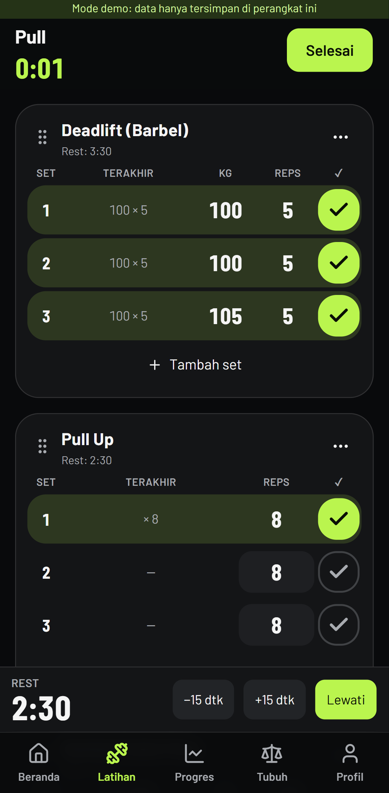

# GymTrack (nama kerja)

PWA pencatat latihan gym — cepat dicatat di sela set, tetap jalan offline, progres jelas. Spesifikasi lengkap: [BRIEF.md](BRIEF.md). Keputusan teknis: [DECISIONS.md](DECISIONS.md).



## Menjalankan

```bash
npm install
npm run dev          # http://localhost:3000
```

Tanpa `.env.local`, app berjalan dalam **mode demo**: semua data di IndexedDB browser, tanpa login. Cocok untuk mencoba UI.

### Menghubungkan Supabase

1. Buat project di supabase.com, salin `.env.example` → `.env.local`, isi URL, publishable key, dan secret key.
2. Terapkan skema:
   ```bash
   npx supabase link --project-ref <ref>
   npx supabase db push
   ```
   Migrations ada di `supabase/migrations/` (skema + RLS, bucket foto privat, batas freemium, data exercise/template bawaan).
3. Auth → URL Configuration: tambahkan `https://<domain>/auth/callback` ke Redirect URLs.
4. Auth → Providers: aktifkan Email (OTP 6 digit) dan Google (Client ID/secret dari Google Cloud).
5. Email template "Magic Link": sertakan `{{ .Token }}` agar user PWA bisa memasukkan kode.

### Pembayaran (Midtrans, sandbox)

Isi `MIDTRANS_SERVER_KEY` dan `NEXT_PUBLIC_MIDTRANS_CLIENT_KEY`, lalu set Payment Notification URL di dashboard Midtrans ke `https://<domain>/api/billing/webhook`.

### Deploy (Vercel)

Import repo, isi env yang sama seperti `.env.local`, deploy. Service worker dibangun otomatis saat `next build`.

## Struktur

```
src/app/(app)/        layar ber-login: home, workout, exercises, templates, programs, progress, body, profile, premium
src/app/(auth)/       login, onboarding, auth/callback
src/app/api/          hapus akun, checkout & webhook Midtrans
src/app/sw.ts         service worker (Serwist)
src/lib/db/           IndexedDB (Dexie), outbox, sync push/pull ke Supabase
src/lib/workout/      aksi sesi latihan, rest timer
src/lib/calc/         1RM (Epley), PR, volume, streak, moving average, konversi satuan
src/lib/entitlements.ts  batas Free vs Premium (satu tempat)
src/lib/ai/training-summary.ts  getTrainingSummary() untuk AI coach nanti
src/lib/analytics.ts  wrapper event analitik
src/messages/         id.json, en.json
supabase/migrations/  SQL + RLS
```

## Test

```bash
npm run check                         # typecheck + lint + unit/DB tests (Vitest)
npm run build && npm run test:e2e     # Playwright, mobile viewport, mode demo
PW_CHANNEL=msedge npm run test:e2e    # pakai Edge/Chrome terpasang, tanpa unduh browser
```

- `tests/unit` — 1RM, deteksi PR, statistik, entitlements, sync offline→online, paritas terjemahan.
- `tests/db/rls.test.ts` — menjalankan migrations asli di Postgres in-process (PGlite) dan membuktikan User A tidak bisa membaca/mengubah data User B, plus batas freemium di server.
- `tests/e2e` — daftar → onboarding → sesi pertama (< 3 menit) → reload di tengah sesi; ulangi sesi = 1 tap per set.

## Status kriteria penerimaan (BRIEF §10)

| Kriteria | Status |
|---|---|
| Daftar → onboarding → sesi pertama < 3 menit | ✅ E2E (mode demo) |
| Set sama dengan sesi lalu = 1 tap | ✅ unit + E2E |
| Sesi aktif utuh setelah ditutup paksa / offline | ✅ IndexedDB + precache; dites dengan server dimatikan |
| 1RM & PR punya unit test | ✅ |
| User A tidak bisa akses data User B (RLS) | ✅ PGlite test |
| Semua teks UI dua bahasa | ✅ test paritas kunci |
| Batasan freemium | ✅ klien + trigger server |
| Lighthouse mobile ≥ 90 | Landing 91–96 / A11y 100 / BP 100; login 81–93 (lihat catatan) |
| Bisa di-install Android & iOS | Manifest + ikon + SW siap; perlu dicek di perangkat nyata setelah deploy HTTPS |
